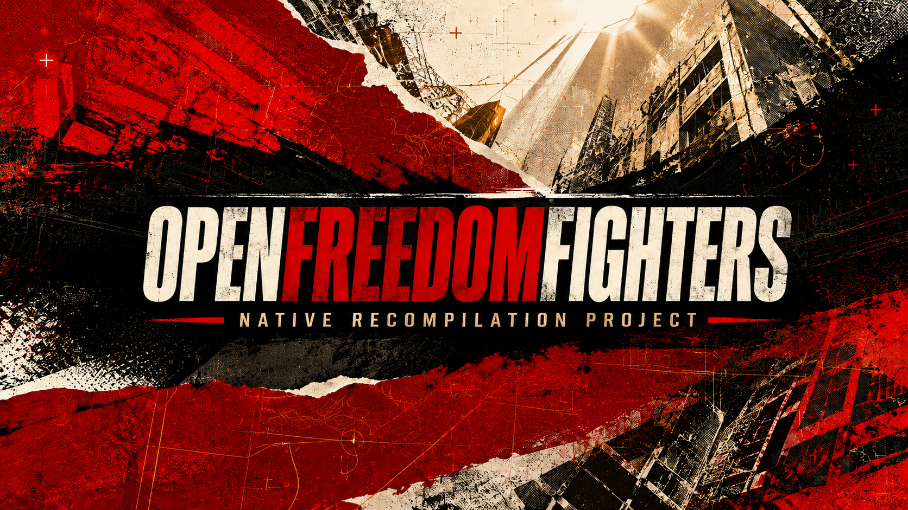

# OpenFreedomFighters

[](https://github.com/yeager/openfreedomfighters/actions/workflows/build.yml)



A clean-room native reimplementation of *Freedom Fighters*, targeting Windows,
macOS, Linux and Steam Deck.

**Not playable yet.** The build opens a window and loads startup data, but
normal startup does not yet run the original intro, menus, or gameplay.

You need your own copy of the game. Buy *Freedom Fighters* from the
[official Steam store page](https://store.steampowered.com/app/1347780/Freedom_Fighters/).
The Steam purchase includes the game and the *Freedom Fighters Soundtrack*.
The supported data set is the Steam Windows release; other editions have not
been validated. No original game files, executable code, soundtrack files, or
other retail assets are included here.

On Linux and Steam Deck, `cmake --install` also installs a standard desktop
entry. It launches the native binary and still requires a verified owned game
data directory at runtime.

By default, OpenFreedomFighters looks for the owned data in
`~/.openfreedomfighters` (or `%USERPROFILE%\\.openfreedomfighters` on Windows).
Pass `--data PATH` to use another location, or set `OPENFREEDOMFIGHTERS_DATA`
for a portable installation.

## Current state

Status reviewed 2026-10-29: the project is a native prototype, not a playable
game. A bounded Linux runtime check confirmed that the SDL Vulkan path can
present the static intro fallback. It does not play the intro timeline or
activate the main menu. Intro playback, intro audio, menu activation, and
gameplay remain unavailable through normal startup; no normal world-scene frame
has been verified. The startup menu's source-backed render plan is prepared but
not submitted in the normal runtime. Runtime captures and retail-derived
analysis remain in private storage and are not part of this repository.

The GitHub Build workflow for commit `1ac6f42` passed on Windows, Linux,
macOS arm64, and macOS Intel, including install-layout checks. This confirms
cross-platform build and packaging checks; it does not verify normal intro or
gameplay rendering.

Normal startup loads the user's local resources and presents a labelled static
intro fallback. This does not confirm animated intro playback, intro audio,
original menus, or gameplay, which remain incomplete. The GPU runtime receives
no active intro frame bridge.

The source audit confirms that normal startup retains a
`NormalIntroSceneSession`, and the SDL GPU runtime binds display dimensions,
camera display-list state, and the static presentation adapter. It does not
construct or activate a `NormalIntroSceneHost`, provide a live frame bridge, or
admit an active intro frame for draw submission. Diagnostic pictures, geometry
previews, and isolated renderer checks do not verify animated playback. The
intro remains a prerequisite for the original main menu and playable-game
milestones. No normal world-scene frame has been verified. See the
[normal startup scene host](docs/NORMAL_STARTUP_SCENE_HOST.md) for the missing
integration boundaries.

Optional FSR SDK build support exists, but the SDL renderer has no FSR frame
adapter or validated gameplay inputs, so FSR remains unavailable at runtime.
See the [FSR integration status](docs/FSR.md).

The diagnostic scene preview is a project-authored inspection tool. It does
not establish gameplay transforms or rendering parity. See the
[transform boundary](docs/TRANSFORM_BOUNDARY.md).

The project includes bounded data readers and a retained diagnostic scene
session. Remaining startup services, lifecycle activation, scene updates, and
draw production must be connected before normal intro playback can begin. See
the [normal startup scene host](docs/NORMAL_STARTUP_SCENE_HOST.md).

Installation validation discovers local files and hashes their contents. The resulting fingerprint identifies
local content for cache and save compatibility; it does not certify publisher
authenticity. Optional soundtrack discovery must remain independent of required
game data. Soundtrack cue mapping and playback remain incomplete. See
[installation validation](docs/INSTALL_MANIFEST.md).

The SDL GPU renderer supports diagnostic picture and geometry presentation.
`--diagnostic-intro-picture` selects the static intro presentation, while
`--diagnostic-scene` opens a geometry preview. These are inspection tools, not
normal scene rendering or parity evidence. Private installation observations,
captures, and executable analysis remain outside this repository.

The optional `OFF_ENABLE_SDL_VULKAN_INTEROP` build adds an SDL external-pass
boundary for future native GPU integrations. No gameplay pass currently uses
it, and it is not a DLSS, FSR, or XeSS implementation. A renderer-backed SDL
active-view host exists, but normal startup does not bind it to an active scene
or produce scene frames. No color/depth/motion-vector input reaches a temporal
resolver. DLSS, FSR, and XeSS remain unavailable at runtime until normal scene
inputs and native submission are connected.

F10 opens the project-authored graphics settings panel. Keyboard and controller
navigation, render scaling, and saved preferences are implemented. An explicit
`--mode` overrides saved preferences for that launch. See
[graphics-settings persistence](docs/GRAPHICS_SETTINGS_PERSISTENCE.md).

Audio decoding, channel services, and an SDL output adapter exist, but the normal
startup audio lifecycle remains disconnected. Localization lookup and camera
registration also need their remaining runtime connections. Project-authored
simulation replays are tooling data and are not retail save files.

The normal startup code still lacks a live scene-owner and frame path for the
intro. Private executable analysis, retail data, and captures stay outside this
repository.

Next: connect the scene's component lifecycle and update loop so normal startup
renders the original intro and reaches its main menu. This takes priority over
graphics polish and more isolated helpers. The
[intro and main-menu plan](docs/INTRO_AND_MENU_PLAN.md) sets the work order,
dependencies and acceptance tests. Format and behavior details remain in the
[intro notes](docs/INTRO_BOOTSTRAP.md); project-wide gates are in the
[roadmap](docs/ROADMAP.md).

## Planned modes

These are targets, not working renderers:

- **Original:** the original gameplay and presentation.
- **Modern:** higher resolutions, improved lighting, shadows and filtering.
- **Modern+:** optional HD assets and future DLSS 4.5, AMD FSR, and Intel XeSS-SR backends on supported hardware.

The settings panel has a mode selector and a working 50--200% render-scale
control. The current SDL Modern path is spatial-only: it records DLSS, FSR, and
XeSS requests but uses fixed render scaling and linear output scaling until a
verified native adapter exists. No portable temporal fallback or resolver is
implemented or exposed. HD asset support is not implemented. See [Modern graphics](docs/MODERN_GRAPHICS.md),
[DLSS](docs/DLSS.md), [FSR](docs/FSR.md), and [XeSS](docs/XESS.md) for scope and licensing.
Project-authored UI strings already select the system locale across 20 locales,
including Swedish. Complete game-text localization, shaping and full retail-font
coverage remain planned. After a verified normal start, a private local cache
extracts supported English LOC source records under opaque stable IDs. A private
runtime session chooses a matching local translation pack by system locale and
falls back to that cache; it does not enable retail-text lookup or publish game
text.

## Build and run

### Required

Build from source needs a C++23 compiler, CMake 3.25 or newer, and development
files for zlib, libogg, libvorbisfile, and FreeType. `libvorbisenc` is optional:
when present, CTest additionally builds independent synthetic Ogg/Vorbis fixture
tests; its absence does not prevent a native runtime build. Ninja is the
recommended generator, but any CMake generator can be used. Git is only needed
to obtain the source tree; it is not consulted by CMake.

The configured native target must be x86-64 on Windows, Linux, or Steam Deck;
macOS accepts arm64 and x86-64 (including an explicit universal pair). CMake
rejects other architectures before it resolves dependencies.

| Platform | Toolchain and direct dependencies |
|---|---|
| Ubuntu/Debian | `build-essential cmake ninja-build pkg-config zlib1g-dev libvorbis-dev libasound2-dev libfreetype-dev libgl-dev libegl-dev libx11-dev libxext-dev libxcursor-dev libxi-dev libxrandr-dev libxss-dev libxtst-dev libxkbcommon-dev libwayland-dev libdecor-0-dev libdbus-1-dev libibus-1.0-dev libsamplerate0-dev libpulse-dev` |
| macOS | Xcode Command Line Tools, then `brew install cmake ninja zlib libvorbis freetype` |
| Windows | Visual Studio 2022 with **Desktop development with C++**, a current Windows SDK, CMake, and either Ninja or the Visual Studio generator. Provide zlib, FreeType, libogg, and libvorbis (including `vorbisfile`; `vorbisenc` enables the additional synthetic fixture tests) through `CMAKE_PREFIX_PATH`. The pinned source-build recipe used by CI is [`.github/actions/windows-dependencies/action.yml`](.github/actions/windows-dependencies/action.yml). |

SDL3 is the only graphics/window/input dependency. CMake uses an installed SDL
3.2+ package when available; otherwise it downloads checksum-pinned SDL 3.4.10
and SDL_ttf 3.2.2 source archives while configuring. That fallback requires
network access and the platform headers SDL itself enables. On Ubuntu/Debian,
the full package list above was verified with a clean Ubuntu 24.04 x86-64
fallback build. Installing a compatible system SDL3 package is usually simpler
for local builds. SDL_ttf is always built from the pinned archive and uses the
required system FreeType.

MP3 and FLAC soundtrack support uses the vendored `dr_mp3` and `dr_flac`
headers, so no MP3 or FLAC development package is needed. Shader compiler tools,
Capstone, and Python analysis dependencies are optional developer tooling;
normal builds use the checked-in generated shaders. See
[THIRD_PARTY.md](THIRD_PARTY.md) for versions, licenses, and the exact optional
tooling roles.

```sh
cmake -S . -B build -G Ninja -DCMAKE_BUILD_TYPE=Debug
cmake --build build
ctest --test-dir build --output-on-failure

# On a Linux builder without a desktop session, run the SDL GPU tests through
# a software-rendered virtual display (install the `xvfb` package first).
LIBGL_ALWAYS_SOFTWARE=1 xvfb-run -a ctest --test-dir build --output-on-failure

# Check your installation without opening a window.
./build/openfreedomfighters --verify-only

# Start the current native prototype.
./build/openfreedomfighters --mode original
```

Use the executable path produced by your build configuration; Windows builds
use `openfreedomfighters.exe`. Replace `original` with `modern` to select the
other profile. Pass `--data /path/to/FreedomFighters` when the owned install is
not in the default location.

F10 toggles settings. In the panel, Page Up/Page Down and controller shoulder
buttons move between rows; D-pad, left stick, arrows, and pointer controls also
work. Close the window to exit. For development:

- `--frame-limit N` exits after a bounded number of rendered frames.
- `--wide-screen` enables the project's widescreen presentation option for
  that launch.
- `--show-graphics-menu` opens settings immediately.
- `--diagnostic-scene` opens a project-authored geometry preview. It is not a
  playable scene or parity evidence.
- `--diagnostic-intro-picture` opens the static intro fallback. It does not
  advance the intro timeline or start intro audio.
- `--screenshot PATH` saves a GPU readback. Keep captures of user-owned data
  outside this repository.

## Clean room and contributions

Research based on the original executable stays private. Public implementation
work follows reviewed behavior specifications. Real game content is read from
the user's installation; independent test fixtures are used in CI.

Do not submit game files, extracted assets, original dialogue, decompiled code
or disassembly listings. Read [CLEAN_ROOM.md](CLEAN_ROOM.md) and
[DATA_POLICY.md](DATA_POLICY.md) before contributing.

Before pushing, scan both history and the working tree:

```sh
gitleaks detect --source . --redact
gitleaks detect --source . --no-git --redact
```

## Documentation

Start with the [roadmap](docs/ROADMAP.md) or
[architecture](docs/ARCHITECTURE.md). The [documentation index](docs/README.md)
covers implementation plans and public platform boundaries.

## License

The project's original code is available under the [MIT license](LICENSE).
This does not cover the original game's code, graphics, music or other assets.
Third-party dependencies retain their own licenses.

Independent fan project; not affiliated with IO Interactive or Electronic Arts.
*Freedom Fighters* and its assets belong to their respective rights holders.
